# P8 Radio — UNIWA P8 development fork

**A modified application based on [SignalDeck](https://github.com/IIMacGyverII/SignalDeck), created by [IIMacGyverII](https://github.com/IIMacGyverII).**

This fork explores running the original SignalDeck radio interface on the **UNIWA P8**, using its existing Android firmware and radio drivers. Our aim is a dependable everyday radio application with root-free hardware access where the P8 firmware permits it, while keeping the original Intercom application available as a fallback.

**This is independent development, not an official SignalDeck release or an endorsement by its creator.** The modified APK is named **P8 Radio (modified)** and uses a separate app identity and icon.

## Credit to the original creator

**Copyright (C) 2026 IIMacGyverII.** SignalDeck's original application, architecture, radio interface, artwork and existing features are the foundation of this work. The P8 contribution adapts and extends that foundation; it does not claim authorship of the original project.

- **Original project and official releases:** [IIMacGyverII/SignalDeck](https://github.com/IIMacGyverII/SignalDeck).
- **Original mission statement, feature documentation and component credits:** [preserved upstream README](README-upstream.md).
- **P8 adaptation:** developed and tested in Econut's UNIWA P8 project, with Codex-assisted implementation and documentation.
- **Licence and notices:** [GPL licence](LICENSE) and [COPYRIGHT / additional terms / third-party credits](COPYRIGHT), retained intact.

The intention is to share the source, evidence and limitations with the original maintainer so suitable changes can be reviewed for possible upstream integration. No upstream acceptance is implied.

## Tested baseline

| Item | Development baseline |
| --- | --- |
| Phone | UNIWA P8, MediaTek MT6765, Android 14 |
| Stock Android build | `P8_EU_U4_A14_NEU_EN_V1.0.1_20250814` |
| Radio module | `DMR003BN.UV4P.V026` |
| Latest device-tested P8 build | `1.0.0-beta.20-p8-main.7c` / version code 145 |
| Source branch | [`uniwa-p8-support`](https://github.com/Econut/SignalDeck/tree/uniwa-p8-support) |
| Original development base | Upstream `a22aaed` / beta.20; upstream has since advanced |

Root-free access works on the tested phone because its UART/sysfs permissions permit it and SELinux is permissive. This is **not a compatibility guarantee for every P8 variant or firmware**. Unlocking, rooting or changing the factory firmware is not required for the tested adapter.

## What the P8 work adds

| Area | P8 adaptation and extensions |
| --- | --- |
| Hardware access | Root-free control and PCM UART adapter using the stock Intercom protocol and existing drivers. |
| Main radio interface | P8 layout, fully visible hold-to-talk control, channel/frequency display and a connection-status icon with details popup. |
| Analogue FM | Tuning, receive playback and manually tested analogue transmit/PTT. |
| Receive audio | Separate module level, Android media volume and software gain controls with level/clipping information. |
| Signal display | Validated module RSSI with short-gap smoothing; received-audio FFT in the existing spectrum panel. The FFT is **audio**, not a swept RF spectrum. |
| Channels and zones | Existing SignalDeck channel database/editor and zones reused; channel-browser View can follow the radio zone, show all channels or show a different named zone. |
| Scan lists | Persistent custom lists spanning zones, membership in the channel editor, receive hold/resume and selectable FM timing. |
| CSV | One versioned import/export format, zone/list membership, validation, duplicate update/skip and confirmed atomic channel-book replacement. |
| Buttons | Physical analogue PTT plus foreground programmable-button assignments, including the P8's Camera-coded bottom-left key. |
| Recovery and evidence | On-device connection recovery, stock-app handover guidance, persistent bounded logs and sharing from the P8 menu. |

Existing upstream features visible elsewhere in the application should not be assumed tested through the P8 adapter. See the limitations below.

## Screenshots from the P8

These are **actual device screenshots of main.7c**, not mockups. Channels and group names illustrate the installed test setup; they are not a recommended frequency plan or permission to transmit. Screens were captured without initiating a P8 transmission or changing saved settings.

<table>
<tr>
<td align="center"><a href="docs/screenshots/p8/main-radio.png">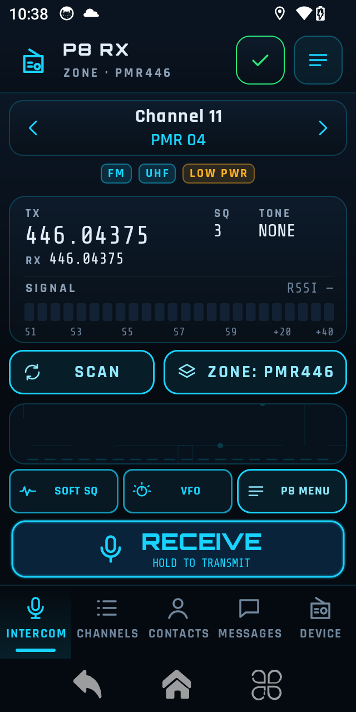</a><br><sub>Main radio: P8 layout and green connection check</sub></td>
<td align="center"><a href="docs/screenshots/p8/p8-menu.png">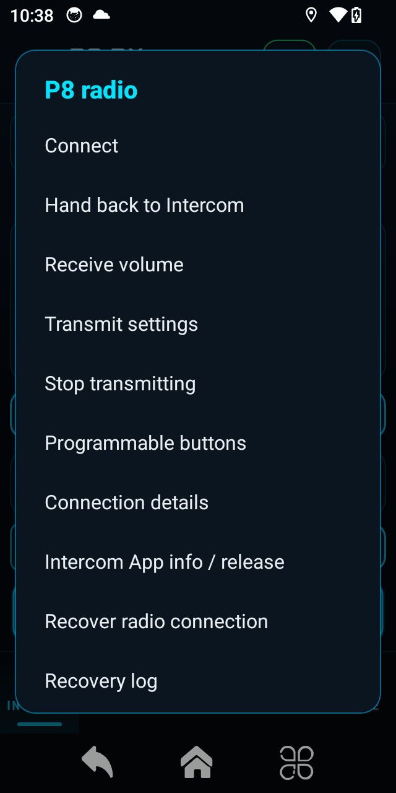</a><br><sub>P8 menu: connection, controls and field recovery</sub></td>
<td align="center"><a href="docs/screenshots/p8/connection-status.png">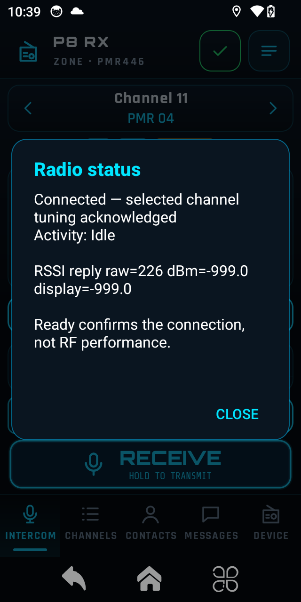</a><br><sub>Tap the header icon for connection/activity details</sub></td>
</tr>
<tr>
<td align="center"><a href="docs/screenshots/p8/receive-volume.png">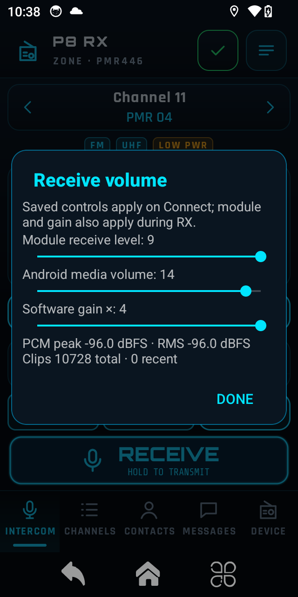</a><br><sub>Receive levels and clipping information</sub></td>
<td align="center"><a href="docs/screenshots/p8/scan-list-picker.png">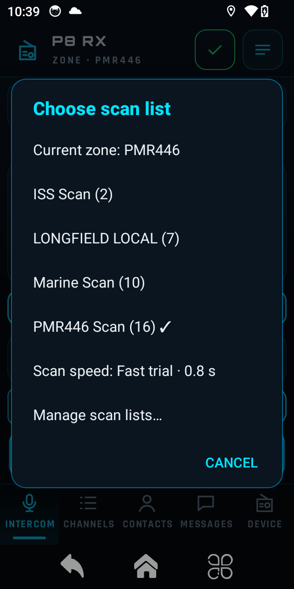</a><br><sub>Saved scan lists, independent of zones</sub></td>
<td align="center"><a href="docs/screenshots/p8/scan-speed-trials.png">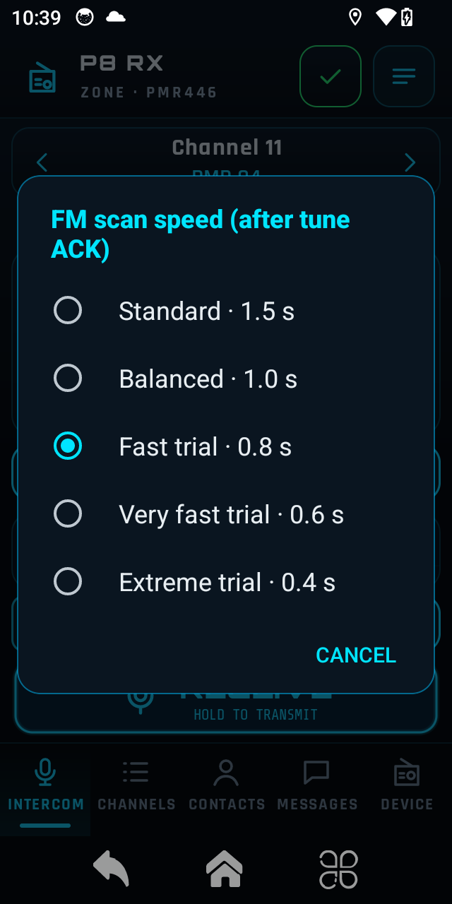</a><br><sub>FM scan timing, including clearly marked trials</sub></td>
</tr>
<tr>
<td align="center"><a href="docs/screenshots/p8/channels.png">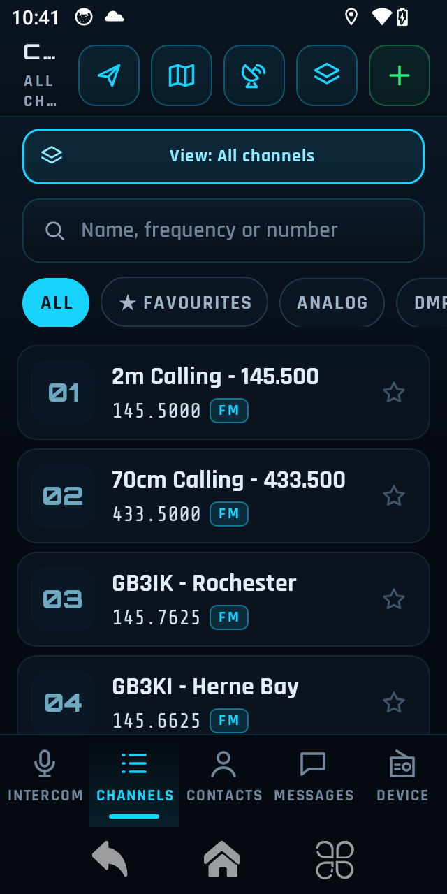</a><br><sub>Channel browser with independent view selection</sub></td>
<td align="center"><a href="docs/screenshots/p8/channel-view-picker.png">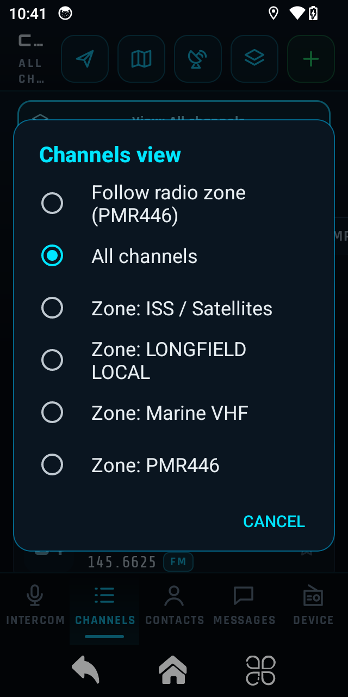</a><br><sub>Browse another zone without changing the radio zone</sub></td>
<td align="center"><a href="docs/screenshots/p8/channel-csv-menu.png">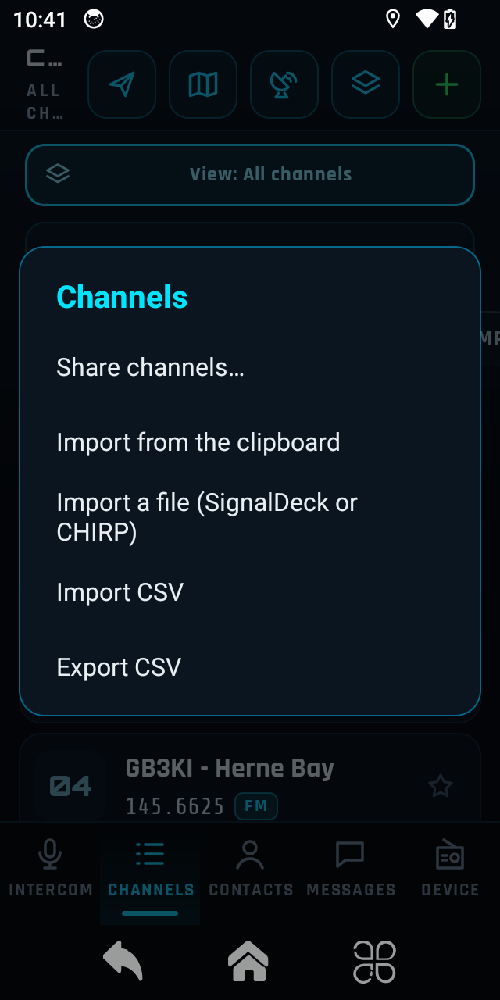</a><br><sub>Standard CSV import/export alongside existing tools</sub></td>
</tr>
<tr>
<td align="center"><a href="docs/screenshots/p8/channel-editor.png">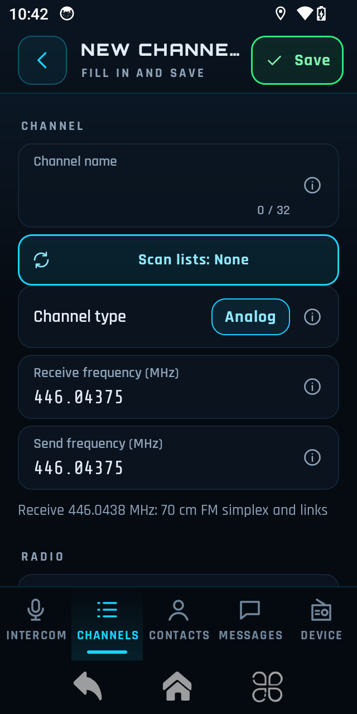</a><br><sub>Existing channel editor extended with scan-list membership</sub></td>
<td align="center"><a href="docs/screenshots/p8/programmable-buttons.png">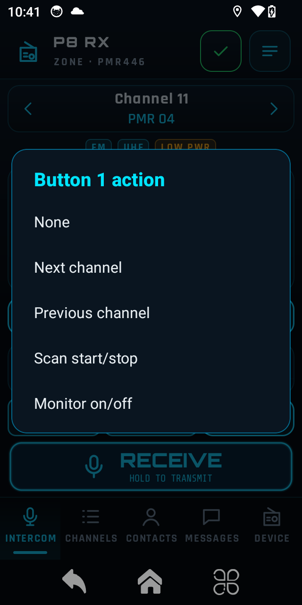</a><br><sub>Foreground programmable-button actions</sub></td>
<td></td>
</tr>
</table>

The original interface screenshots remain in the [upstream README](README-upstream.md#screenshots) for context and comparison. Green **Ready** means an acknowledged connection/tune, not proof of RF reception quality or transmission.

## Current limitations — please read before trying it

- **Startup and handover are unfinished.** After some cold starts, the stock Intercom app must initialize the radio before SignalDeck can connect. Root-free Android still requires a manual Intercom Force stop through App info. Do not disable/remove Intercom expecting that dependency to be solved.
- **Recovery is bounded, not a factory reset.** It closes the current session, releases and verifies PTT, and clears resolved connection faults. It does not hide failed UART restoration or unexpected hardware states. Persistent logs help investigate field incidents.
- **DMR is not yet validated end to end on this P8.** Packet construction and settings are not evidence of working P8 DMR voice reception/transmission.
- **Fast scanning is experimental.** 0.6/0.4-second FM settings passed isolated timing/hold checks, but require field testing for weak and short signals. Actual hop time includes retuning/scheduling overhead. DMR dwell remains 1.5 seconds.
- **Background/lock-screen reliability, independent reboot startup and Phone only/module power control need more work.** Generic upstream root/boot options are not proof of support in this root-free P8 path.
- **Secondary-screen layout polish remains in progress**, including crowded toolbar headings on the small display. Screenshots show the current build honestly.
- **No supported aviation AM mode has been found.** An application change cannot be assumed to add a missing RF demodulator.
- No calibration modification, firmware flashing or bootloader unlock is part of this fork's normal setup. Keep original firmware and device-specific backups private and intact.

## Build and setup

This fork currently provides source and documentation; it has **not published a public P8 APK release**. Do not confuse the original project's APK releases with a P8 development build.

With the repository's normal Android build dependencies (JDK 17, SDK 34 and configured NDK):

```sh
./gradlew -Pp8Offline=true -Pp8OpenProbeReviewed=true -Pp8TxTestReviewed=true assembleRelease
```

The flags explicitly enable the P8 hardware boundaries. They do not establish hardware compatibility or authorise RF transmission. Use your own development signing configuration; no private signing credentials are included here. The P8 edition's app ID is `com.macdmr.radio.p8lab`.

On matching hardware, keep Intercom installed, initialize it when necessary, then use the P8 menu's Connect/handover instructions. Use [Recover radio connection](docs/p8-field-recovery.md) if a resolved fault remains latched. Saved channels/settings are separate from the APK; use CSV to transfer channel books.

## Development notes and tests

- [Contribution handover and remaining integration work](docs/p8-contribution-handover.md)
- [Protocol, hardware and stock-app evidence](docs/uniwa-p8.md)
- [Root-free access milestones](docs/p8-rootfree-progress.md)
- [Main radio integration](docs/p8-main-radio.md)
- [Channels, zones, scan lists and timing](docs/p8-channels-and-scan-lists.md)
- [CSV format, templates and validation](docs/p8-csv-format-v1.md)
- [On-device recovery and persistent logs](docs/p8-field-recovery.md)
- [Aviation AM assessment](docs/p8-aviation-am-assessment.md)

Focused host tests cover protocol framing, settings, CSV, channel scopes, RSSI, recovery and other P8 policies. Isolated on-device tests use scratch databases, fake scanner hosts and detached PTT views. They do not replace live radio testing; milestone documents distinguish those results and known gaps. Not every historical test was rerun for every subsequent change.

```sh
./gradlew -Pp8Offline=true :app:testReleaseUnitTest --tests 'com.macdmr.radio.P8*' --tests 'com.macdmr.radio.ChannelListScopeTest'
```

No personal firmware backups, calibration dumps, stock APKs, private keys or personal channel-export files are included in this contribution. Original project and third-party credit notices remain in [COPYRIGHT](COPYRIGHT).
